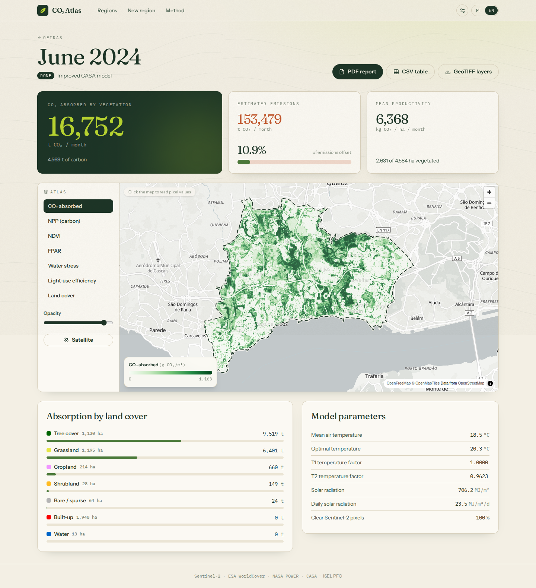
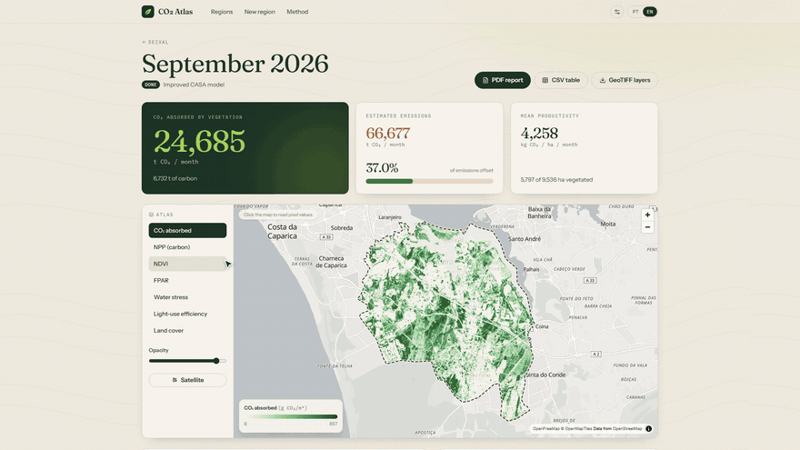

<p align="center">
  
</p>

<h1 align="center">CO₂ Absorption Calculator</h1>

<p align="center">
  <b>English</b> · <a href="#-português">Português</a>
</p>

<p align="center">
  Estimate how much CO₂ the vegetation of <b>any region</b> absorbs each month — from Sentinel-2 satellite imagery, ESA WorldCover land cover and NASA POWER climate data — and compare it with local emissions.
</p>

<p align="center">
  <a href="https://github.com/tibi-tech/CO2-Absorption-Calculator/actions/workflows/ci.yml"></a>
  <a href="LICENSE"></a>
  
  
</p>

<p align="center">
  
</p>

## Demo

<p align="center">
  <a href="docs/video/demo-voiceover.mp4"></a>
</p>

<p align="center">
  ▶ Full 2-minute demo: <a href="docs/video/demo-voiceover.mp4">with voiceover</a> · <a href="docs/video/demo-captions.mp4">captions only</a>
</p>

---

## Contents

[Overview](#overview) · [Method](#method) · [Example results](#example-results) · [Getting started](#getting-started) · [Configuration](#configuration) · [Data sources & costs](#data-sources--costs) · [Limitations](#limitations) · [API](#api) · [Roadmap](#roadmap) · [References](#references)

## Overview

This web app rebuilds a final-year project (PFC, ISEL) originally written as a Windows Tkinter app for the municipality of Oeiras, Portugal. It now runs in the browser and works for any area up to 1 000 km².

- 🗺️ **Any region**: draw a polygon or rectangle, search a place (OpenStreetMap boundaries) or upload a GeoJSON / zipped shapefile
- 🛰️ **Satellite processing in the background**: cloud-masked Sentinel-2 composites via Copernicus openEO and WorldCover from ESA's public files, with live progress
- 📈 **Results dashboard**: CO₂ absorbed, emissions offset, productivity per hectare, totals by land cover and a month-by-month chart
- 🧭 **Interactive atlas**: CO₂, NPP, NDVI, FPAR, water stress, light-use efficiency and land-cover layers, with pixel values on click
- 📄 **Exports**: PDF report (PT/EN), CSV table, GeoTIFF layers
- 🌍 **Portuguese & English** interface
- 🎓 **Thesis reference**: the original Oeiras June 2024 result is bundled and reproduced (20 384 t CO₂ vs 20 228 t in the thesis, < 1 % difference)

## Method

Net primary productivity is computed with the **CASA** light-use-efficiency model and converted to CO₂:

$$NPP = 0.5 \cdot SOL \cdot FPAR \cdot T_1 \cdot T_2 \cdot WSC \cdot E_{max} \qquad CO_2 = NPP \times \tfrac{44}{12}$$

| Term | Source | Description |
|---|---|---|
| `SOL` | NASA POWER `ALLSKY_SFC_SW_DWN` | Monthly incoming solar radiation (MJ/m²) |
| `FPAR` | Sentinel-2 B04, B08 | Absorbed fraction of PAR, linear in NDVI between the CASA references 0.023–0.70 (Zhu et al., 2006) |
| `T1`, `T2` | NASA POWER `T2M` | Temperature stress from monthly mean air temperature and T_opt (warmest month) |
| `WSC` | Sentinel-2 B11, B12 | Water stress from the Shortwave Infrared Moisture Index, normalised within the region (2nd–98th percentile; Fensholt & Sandholt, 2003), 0.5–1 |
| `E_max` | ESA WorldCover 2021 | Maximum light-use efficiency per land-cover class (editable) |

All layers are resampled onto one 10 m UTM grid. Results are totalled using the real pixel area. If a month has too few cloud-free pixels, a 3-month window is used. If NASA POWER hasn't published a month yet, the 5-year average is used. Both cases are flagged in the results.

<details>
<summary>Improvements over the original thesis code</summary>

- Works for any region (no hard-coded Oeiras inputs)
- Correct georeferenced resampling (the original stretched images with an image library)
- Fixed CASA NDVI references for FPAR, so months are comparable (the original stretched each scene between its own min and max)
- Real solar radiation per year and month instead of a fixed raster × monthly percentage
- Real air temperature instead of a Sentinel-3 day/night filter that did not filter by time of day
- Proper SCL cloud masking and median compositing over the whole month
- Non-interactive Copernicus authentication, caching, background jobs

</details>

## Example results

Oeiras, Portugal (45.8 km², 2,631 ha vegetated), June 2024:

| | Thesis method | Improved model |
|---|---|---|
| CO₂ absorbed | 20,384 t | **16,752 t** |
| Emissions offset | 13.3 % | **10.9 %** |
| Mean NDVI | 0.343 | 0.344 |
| Mean FPAR | 0.607 | 0.446 |
| Mean WSC | 0.864 | 0.781 |
| Solar radiation | 744 MJ/m² | 706 MJ/m² |

The satellite inputs agree (same NDVI and vegetated area). The difference comes from the method: fixed CASA references for FPAR instead of per-image stretching, percentile-based water stress, and the measured solar radiation for that month. The thesis method is still available for this region and reproduces the original result (20,228 t) within 1 %.

## Tech stack

| | |
|---|---|
| Backend | Python 3.12 · FastAPI · SQLModel (SQLite) · rasterio · numpy · shapely · openEO · reportlab |
| Frontend | React 19 · TypeScript · Vite · Tailwind CSS 4 · MapLibre GL · terra-draw · Recharts · i18next |
| Deploy | Single Docker image (API + static frontend) |

## Getting started

### 1. Copernicus credentials

Create a free account at [dataspace.copernicus.eu](https://dataspace.copernicus.eu/) and an OAuth client in the [dashboard](https://shapps.dataspace.copernicus.eu/dashboard/) (*User settings* → *OAuth clients* → *Create*). Then use **one** of these options:

- **Settings page (easiest)**: open the app → ⚙ **Settings**, paste the Client ID and secret, and click *Verify & save*. The credentials are checked with Copernicus and stored only on the server (`DATA_DIR/credentials.json`, mode 600). The secret is never sent back to the browser. For safety the page only accepts changes from the computer running the app, or from anywhere once `DEMO_PASSWORD` is set.
- **`.env` file**: set `CDSE_CLIENT_ID` / `CDSE_CLIENT_SECRET`. This takes priority over the settings page.
- **One-time login**: run `uv run python -m app.cli login` in `backend/` and follow the link. A refresh token is stored for the worker.

```bash
cp .env.example .env   # optional: credentials, DEMO_PASSWORD
```

### 2a. Run with Docker

```bash
docker compose up --build
# → http://localhost:8000
```

### 2b. Run for development

Requires [uv](https://docs.astral.sh/uv/) and Node.js 22.

```bash
# backend (http://localhost:8000)
cd backend
uv sync
uv run uvicorn app.main:app --reload

# frontend (http://localhost:5173, proxies /api to the backend)
cd frontend
npm install
npm run dev
```

### Tests

```bash
cd backend && uv run pytest     # unit tests + thesis regression + API
cd frontend && npm run build    # type-check + build
```

## Configuration

| Variable | Default | Description |
|---|---|---|
| `CDSE_CLIENT_ID` / `CDSE_CLIENT_SECRET` | – | Copernicus Data Space OAuth client (alternatively set in ⚙ Settings) |
| `DEMO_PASSWORD` | – | If set, creating regions, starting runs and changing settings require it. Viewing stays public |
| `DATA_DIR` | `backend/data` | SQLite database, cache and run outputs |
| `MAX_REGION_KM2` | `1000` | Maximum region area |
| `MAX_MONTHS_PER_JOB` | `12` | Maximum months per request |
| `SEED_OEIRAS` | `true` | Create the Oeiras reference region and thesis run on first start |
| `OPENEO_TIMEOUT_MIN` | `60` | Cancel a Copernicus job that hasn't finished (queue + processing) after this many minutes |

## Data sources & costs

| Data | Provider | Access | Cost |
|---|---|---|---|
| Sentinel-2 L2A (B04, B08, B11, B12, SCL) | Copernicus Data Space Ecosystem | openEO batch job | openEO credits from the free account, ≈ 9 per month for a municipality-sized region |
| Land cover 2021 v200 | ESA WorldCover | Public Cloud-Optimised GeoTIFFs on AWS | Free, no account |
| Solar radiation, air temperature | NASA POWER | REST API | Free, no account |
| Place search and boundaries | OpenStreetMap / Nominatim | REST API | Free |

Downloaded imagery is cached per region and month, so re-running a month costs no credits and takes seconds. The ⚙ Settings page shows the credits used this month. A first run usually takes 2–5 minutes, mostly waiting in the shared Copernicus queue.

## Limitations

- **Estimates, not certified accounting.** Results come from a light-use-efficiency model. They are suitable for education, research and comparing areas or months, not for carbon credits or official inventories.
- **Climate is sampled at the region's centre** at NASA POWER's ~0.5° resolution. Recent months (≈ 2–3 months) are not yet published and use the 5-year average for that month.
- **Water stress is relative to the region.** WSC is normalised within each region, so very uniform regions (all dry or all irrigated) are less well represented.
- **Land cover is fixed to 2021.** Changes since then (new buildings, felled forest) are not reflected.
- **Cloudy months** with too few clear pixels use a 3-month composite.
- Only vegetation net primary productivity is modelled; soil respiration and other carbon fluxes are not included.

## Project structure

```
backend/
  app/
    api/         REST endpoints (regions, runs, exports, progress stream)
    pipeline/    grid, parameters (vegetation, climate, land cover), NPP, analysis, runner
      sources/   Copernicus openEO, ESA WorldCover and NASA POWER clients
    services/    background worker, credentials, map rendering, PDF/CSV/ZIP exports
  tests/         unit, regression (thesis) and API tests + Oeiras fixtures
frontend/
  src/           pages, components, map helpers, i18n (pt/en)
docs/
  reports/       thesis reports (initial, intermediate, final)
  posters/       project posters
  images/        README screenshots
```

## API

Interactive docs at `/docs` when the server is running. Main endpoints:

```
GET/POST /api/regions                 POST /api/regions/parse (file upload)
GET      /api/regions/{id}/timeseries
POST     /api/runs                    GET /api/runs/{id}    GET /api/runs/{id}/events (SSE)
GET      /api/runs/{id}/layers/{name}.png
GET      /api/runs/{id}/sample?lon=&lat=
GET      /api/runs/{id}/export.{pdf|csv|zip}?lang=pt|en
GET      /api/settings                PUT/DELETE /api/settings/copernicus
GET      /api/settings/copernicus/usage
```

## Roadmap

Planned features and development phases are described in [ROADMAP.md](ROADMAP.md).

## Project documents

The original final-year project (PFC, ISEL) reports and posters, in Portuguese:

- Reports: [initial](docs/reports/Relatório%20Inicial-P33.pdf) · [intermediate](docs/reports/Relatório%20Intermédio-P33.pdf) · [final](docs/reports/Relatório%20Final-P33.pdf)
- Posters: [intermediate](docs/posters/Poster%20Intermédio%20PFC.pdf) · [final](docs/posters/Poster%20Final%20PFC.pdf)

## References

- Potter, C. S. et al. (1993). Terrestrial ecosystem production: a process model based on global satellite and surface data. *Global Biogeochemical Cycles*, 7(4), 811–841.
- Zhu, W., Pan, Y., He, H. et al. (2006). Simulation of maximum light use efficiency for some typical vegetation types in China. *Chinese Science Bulletin*, 51, 457–463.
- Fensholt, R. & Sandholt, I. (2003). Derivation of a shortwave infrared water stress index from MODIS near- and shortwave infrared data in a semiarid environment. *Remote Sensing of Environment*, 87(1), 111–121.
- Zanaga, D. et al. (2022). *ESA WorldCover 10 m 2021 v200*. doi:10.5281/zenodo.7254221

## Acknowledgements & data attribution

- Contains modified Copernicus Sentinel data (2024–2026), processed by the Copernicus Data Space Ecosystem.
- © ESA WorldCover project 2021 / contains modified Copernicus Sentinel data (2021) processed by the ESA WorldCover consortium.
- Climate data from the NASA Langley Research Center (LaRC) POWER Project, funded through the NASA Earth Science/Applied Science Program.
- Map data © OpenStreetMap contributors; base map tiles by OpenFreeMap.
- Originally developed as a final-year project at ISEL — Instituto Superior de Engenharia de Lisboa.

## License

[MIT](LICENSE)

---

## 🇵🇹 Português

Estime quanto CO₂ a vegetação de **qualquer região** absorve por mês, a partir de imagens de satélite Sentinel-2, uso do solo ESA WorldCover e dados climáticos NASA POWER, e compare com as emissões locais.

### Sobre

Esta aplicação web reconstrói o projeto final de curso (PFC, ISEL), originalmente uma aplicação Windows (Tkinter) para o concelho de Oeiras. Agora corre no navegador e funciona para qualquer área até 1 000 km².

- 🗺️ **Qualquer região**: desenhe um polígono ou retângulo, procure um local (limites OpenStreetMap) ou carregue um GeoJSON / shapefile em .zip
- 🛰️ **Processamento de satélite em segundo plano**: compósitos Sentinel-2 sem nuvens via Copernicus openEO e WorldCover a partir dos ficheiros públicos da ESA, com progresso em tempo real
- 📈 **Painel de resultados**: CO₂ absorvido, compensação das emissões, produtividade por hectare, totais por uso do solo e gráfico mensal
- 🧭 **Atlas interativo**: camadas de CO₂, NPP, NDVI, FPAR, stress hídrico, eficiência de uso da luz e uso do solo, com valores do píxel ao clicar
- 📄 **Exportação**: relatório PDF (PT/EN), tabela CSV, camadas GeoTIFF
- 🎓 **Referência da tese**: o resultado original de Oeiras (junho de 2024) está incluído e é reproduzido (20 384 t CO₂ vs 20 228 t na tese, diferença < 1 %)

### Método

A produtividade primária líquida é calculada com o modelo **CASA** e convertida em CO₂ (`NPP = 0,5 · SOL · FPAR · T1 · T2 · WSC · Eₘₐₓ`, `CO₂ = NPP × 44/12`). Veja a tabela de parâmetros acima ou a página *Método* na aplicação.

### Como executar

1. Crie uma conta gratuita em [dataspace.copernicus.eu](https://dataspace.copernicus.eu/) e um cliente OAuth (*User settings → OAuth clients* no [dashboard](https://shapps.dataspace.copernicus.eu/dashboard/)).
2. `docker compose up --build` e abra http://localhost:8000.
3. Em ⚙ **Definições**, cole o Client ID e o secret e clique em *Verificar e guardar*. Em alternativa, use `CDSE_CLIENT_ID` / `CDSE_CLIENT_SECRET` no `.env` ou `uv run python -m app.cli login`.

Para desenvolvimento: `uv sync && uv run uvicorn app.main:app --reload` em `backend/` e `npm install && npm run dev` em `frontend/`.

### Documentação

Os relatórios (inicial, intermédio e final) e os pósteres do projeto estão em [`docs/`](docs/).

### Limitações

Os resultados são **estimativas** de um modelo de eficiência no uso da luz, adequadas para ensino, investigação e comparação entre áreas ou meses, não para créditos de carbono ou inventários oficiais. O clima é amostrado no centro da região, os meses mais recentes usam a média de 5 anos, e o uso do solo é de 2021. Veja a secção [Limitations](#limitations) para os detalhes.

### Roteiro

As próximas fases de desenvolvimento estão descritas em [ROADMAP.md](ROADMAP.md).

### Licença

[MIT](LICENSE)
